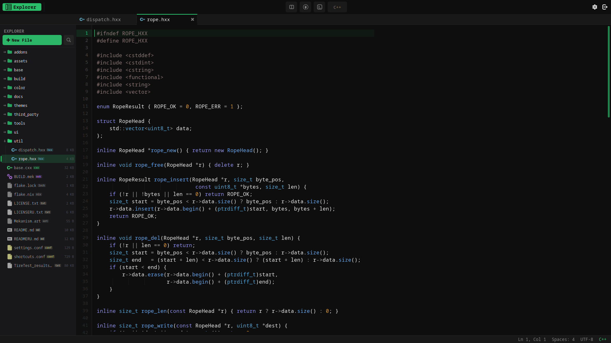
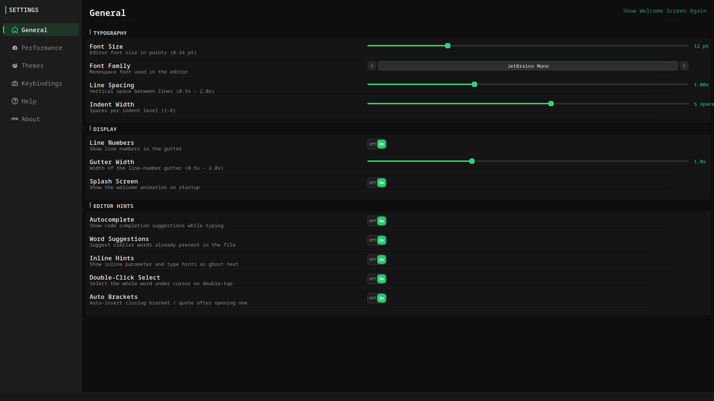

# Textor

Textor is a lightweight, fast code editor with GLX acceleration, syntax highlighting, sidebar, tabs, console and addon support. :)




---

## Installation and assembly

### Dependencies

| Distribution | Team |
|---|---|
| Arch/Artix | `pacman -Syyu xorg cairo pango lib32-pango mesa` |
| Debian/Ubuntu | `apt install libx11-dev libcairo2-dev libpango1.0-dev libgl1-mesa-dev` |
| NixOS | use `flake.nix` |

**Compiler:** Clang or GCC with C++17 support
**Tools:** [Mekanism](https://codeberg.org/Ezerit/mekanism.git) (build system)

### Build steps

```bash
#1. Clone the repository
git clone https://codeberg.org/Ezerit/textor.git
cd textor

#2. Install and build Mekanism
git clone https://codeberg.org/Ezerit/mekanism.git
cd mekanism && ./clang++ -O3 -std=c++17 -D_XOPEN_SOURCE=700 -Wall -I. mekanism.cxx -o build/mekanism
cd ../

#3. Build Textor
./mekanism base

#4. Launch
./build/textor
```

**NixOS:**
```bash
nix build
./result/bin/textor
```

---

## Code architecture

Textor is written in C++17 as a single header-only project. All modules are `.hxx` files.

```
textor/
+-- base.cxx # Entry point: X11/macOS mainloop, GPU blit
+-- BUILD.mek # Build file (Mekanism)
|
+--ui/
| +-- editor.hxx # * Main object Editor + draw_ui()
| +-- code_editor.hxx # CodeEditor: buffer (Rope), cursor, highlighting, drawing
| +-- scroll_bar.hxx # ScrollBar: vertical and horizontal scrollbars
| +-- sidebar.hxx # Sidebar: file tree
| +-- settings_tab.hxx # SettingsTab: settings tab
| +-- settings_modal.hxx # SettingsModal: modal window (deprecated)
| +-- console_panel.hxx # ConsolePanel: built-in console
| +-- file_picker.hxx # FilePicker: file selection dialog
| +-- animations.hxx # AnimController, ThemeTween: animations
| +-- autocomplete.hxx # Autocomplete
| +-- adco.hxx # Adco language engine (themes and addons)
| +-- addon_loader.hxx # loads .adco files (languages + themes)
| +-- shortcut_manager.hxx # Managing shortcuts (shortcuts.conf)
| +-- bar_button.hxx # BarIcon: activity bar buttons
| +-- button.hxx # TextButton: save button
| +-- rope.hxx              # Rope: text buffer data structure (pure C++)
| +-- globals.hxx # Global variables (g_animations_enabled, etc.)
| +-- platform.hxx # Platform-specific code
| +-- icons.hxx # SVG icons
| +-- splash.hxx # Startup splash screen (simple logo)
| +-- command_palette.hxx # Command palette (Ctrl+Shift+P, Ctrl+P)
| |
| +-- draw_helpers.hxx # [NEW] Cairo Helper Functions (draw_rounded_rect_ed)
| +-- renderer.hxx # [NEW] Rendering pipeline documentation
| +-- tab_manager.hxx # [NEW] Documentation of the tab system
| +-- input_handler.hxx # [NEW] Input handling documentation
|
+-- color/
| +-- themes.hxx # ThemeVariant, ThemeTween: design themes
|
+-- metal/
| +-- blit.metal # Metal shader (macOS GPU blit)
|
+-- themes/ # .adco theme files
+-- addons/ # .adco addon files (language support)
+-- shortcuts.conf # Shortcut settings
+-- settings.conf # Editor settings
```

### How to add a new interface element

1. **Declare data** in `struct Editor` (editor.hxx)
2. **Draw** in `draw_ui()` in the correct Z-order (last = on top)
3. **Add hit-test** to `handle_mouse_click()` and `handle_mouse_move()`
4. See `ui/renderer.hxx` and `ui/input_handler.hxx` for documentation

---

## Rendering pipeline

```
base.cxx mainloop 
| 
+-- X11 events -> Editor::handle_*() 
| 
+-- draw_ui(cr, surf, editor) <- CPU: Cairo on s_frame_buf 
| 
+-- activity bar 
+-- tab bar 
+-- gutter (line numbers) 
+-- code area -> CodeEditor::draw_text_area() 
+-- find bar overlay 
+-- scrollbars 
+--console 
+-- sidebar overlay (on top of everything) 
+-- addons panel 
| 
v (GPU mode) 
gpu_blit() -> glTexSubImage2D (modified stripe only) 
| 
+-- GL overlay: selection via OpenGL
```

**Performance Optimizations:**
- `dirty_rect` - partial update of the GPU texture (only changed lines)
- `SmartRender` - only visible lines are drawn (`start_ln..end_ln`)
- `sleep tiers` - with idle > 3s: 2 fps, almost 0% CPU
- GL overlay - the selection is drawn through OpenGL, bypassing Cairo

---

## Interface

### Key Areas

| Region | Description |
|---|---|
| **Activity Bar** | Vertical panel on the left: sidebar, addons, console, settings, exit |
| **Tab Bar** | Horizontal tab bar. Scrolls with mouse wheel |
| **Sidebar** | File tree (floating overlay). Ctrl+B or button |
| **Gutter** | Line numbers to the left of the code |
| **Text Area** | Main editing area |
| **Console** | Built-in con
salt from below. Ctrl+\` or button |
| **Find Bar** | Search in all files (Ctrl+F) or in the current file (Ctrl+Shift+F); Tab switches the mode |

### File icons

Language icons are SVG files in `assets/icons/` (C, C++, Bash, JavaScript, TypeScript, Kotlin, Lua, Mekanism, Nim, Python, Ruby, Rust, Swift, Go, Java, D, HTML, CSS, JSON, YAML, TOML, Markdown, .adco).
They are packed into the binary and drawn in the language colour, so they follow the theme.
To add or change an icon: put `name.svg` into `assets/icons/`, add the extension to `name_for()` in `ui/svg_icons.hxx`
and run `lua tools/embed_icons.lua`. Files without any SVG icon get a plain file shape in the language colour.
Addons bring their own icon: `addons/<name>/<name>.adco` names it (`icon { svg: "<name>.svg" }`)
and the file lies in `addons/<name>/svg/`. The addon icon wins over the built-in one (see `docs/ADCO.md`).
The icons of the editor itself (activity bar, Settings sections, folders, search) are in `assets/icons/ui/`
and are drawn through `morph::draw_icon`. Sliders look the same everywhere: `morph::draw_slider_bar`.
The Explorer watches the disk: files created or deleted outside the editor (terminal, file manager) show up within a second.
SVG parsing: [nanosvg](https://github.com/memononen/nanosvg) (zlib license), `third_party/nanosvg/`.

### Shortcuts (default)

| Action | Shortcut |
|---|---|
| Open file | Ctrl+O |
| New file | Ctrl+N |
| Save | Ctrl+S |
| Close tab | Ctrl+W |
| Next tab | Ctrl+Tab |
| Previous tab | Ctrl+Shift+Tab |
| Settings | Ctrl+, |
| Sidebar | Ctrl+B |
| Console | Ctrl+\` |
| Search in all files | Ctrl+F |
| Search in current file | Ctrl+Shift+F |
| To cursor | Ctrl+L |
| Exit | Ctrl+Q |

Shortcuts can be reassigned in `shortcuts.conf` or through the Settings tab.

---

## Themes and settings

Themes are written in Adco (`.adco` files) in `themes/` or `~/.config/textor/themes/`.
See [docs/ADCO.md](docs/ADCO.md) and `themes/example.adco`.
Ready-made themes in `themes/`: Midnight Ocean, Amber Forge, Nord Frost, Rose Dusk, Example Amber.
In the command palette (Ctrl+Shift+P) type a theme name: the highlighted theme is shown at once, Enter keeps it, Esc brings the old one back.

Settings are saved in `~/.config/textor/settings.conf`.

**Performance Options** (Settings -> Performance):
- **Animations** - smooth transition animations
- **Rounded corners** - rounding of elements
- **Text optimization** - CPU savings when rendering text
- **Line scroll** - scrolling by lines instead of pixels
- **Smart render** - draw only visible lines

---

## Addons

Addons are `.adco` files in `addons/` or `~/.config/textor/addons/`.
An addon adds language support (highlighting, comments, completions, file icon) and can bundle themes.
C, C++, D, Rust, Python, Shell, Lua, Kotlin, Mekanism and config files are highlighted by the editor itself;
Adco and every other language come from addons.

The language is described in [docs/ADCO.md](docs/ADCO.md); `addons/lua.adco` is a small example.

---

## Interface

The layout follows Lapce: horizontal file tabs under the top bar, a status bar at the bottom
(line and column, indent, encoding, language) and a command palette.
In focus mode (F11) the top bar and the tabs slide off the top edge together and the editor moves up;
move the pointer to the top edge to bring them back, and to the left edge for the Explorer.

| Action | Shortcut |
|---|---|
| Command palette | Ctrl+Shift+P |
| Go to open file / theme / command | Ctrl+P |

---

## Changes in this version

### ! Bugs fixed
- Fixed a comment error in `morphing.cxx` at line 1122
- Fixed multi-cursor functionality
- Fixed cursor scrolling
- **[NEW]** Added table rendering for Markdown

### ! New features
- **Match markers on the scrollbar** - when searching (Ctrl+F) or selecting a word, circles appear on the scrollbar track, showing where there are matches. Active matches are highlighted brighter
- **Animation find bar** - smooth appearance/hiding of the search bar
- **Ctrl+F with selection** - if text is selected before pressing Ctrl+F, it immediately becomes a request

### ! Memory optimization
- **Buffer cache** - `get_buffer_str()` caches `buffer.to_string()` and invalidates it on every edit. Search, undo, autocomplete no longer copy the entire file every time
- **deque for undo stack** - `erase(begin())` is now O(1) instead of O(n)
- **Adaptive MAX_UNDO** - for files > 100KB the undo limit is reduced from 200 to 50 records (saving hundreds of MB for large files)
- **find_bar.clear()** - the match vector is released immediately via swap-trick

### ! Refactoring
- New modules with documentation: `draw_helpers.hxx`, `renderer.hxx`, `tab_manager.hxx`, `input_handler.hxx`
- All basic structures and methods are documented in Russian
- Render acceleration: dirty-rect partial GPU upload (modified lines only)
- Sleep tiers: idle > 3s -> 2fps, almost 0% CPU

---

## Problem solving

**The cursor 'teleports' up** when editing at the bottom of the file:
> `ensure_cursor_visible` should use `abs_cy = line * line_h + pos.y`

**Selection remains in settings:**
> Fixed in this version: `gpu_sel_active` is reset in `switch_to_tab()` and when drawing the settings tab

**Scrollbar goes out of bounds:**
> Fixed in `scroll_bar.hxx`: thumb is now clamped via `std::clamp(thumb_raw, 0.0, track_h - thumb_h)`

**How to participate in development:**
Submit patches in `git diff` format as a pull request to Codeberg.
In the PR description, indicate: the purpose of the change, the affected files, before/after behavior.
